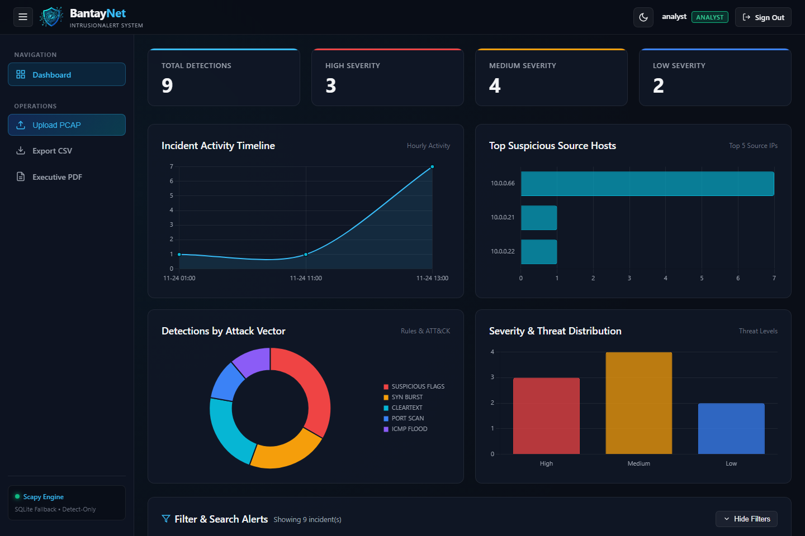
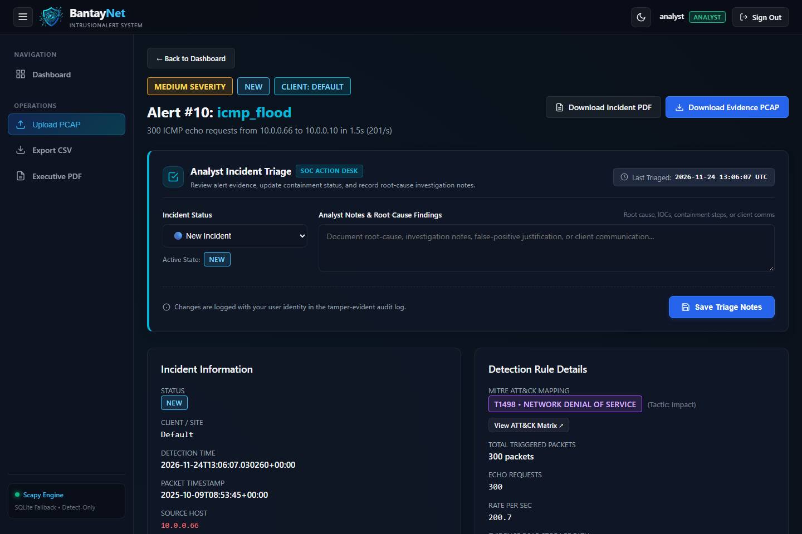
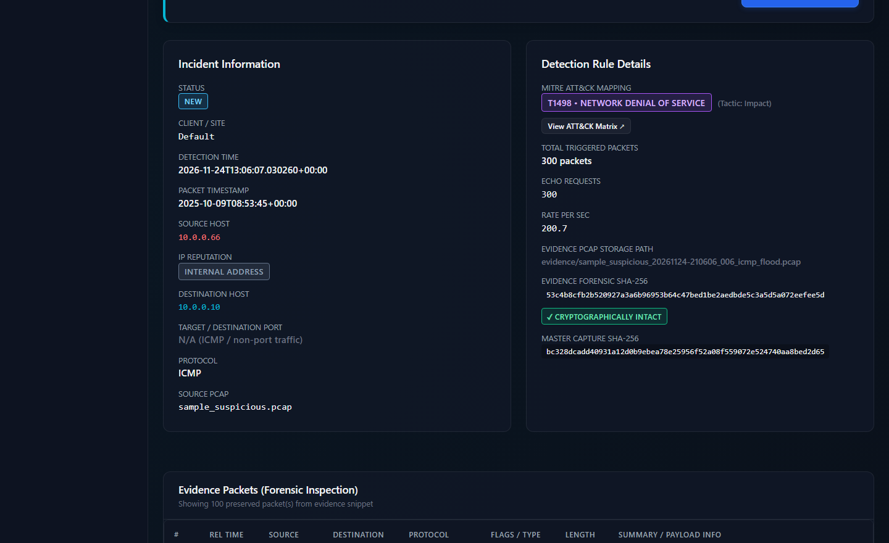
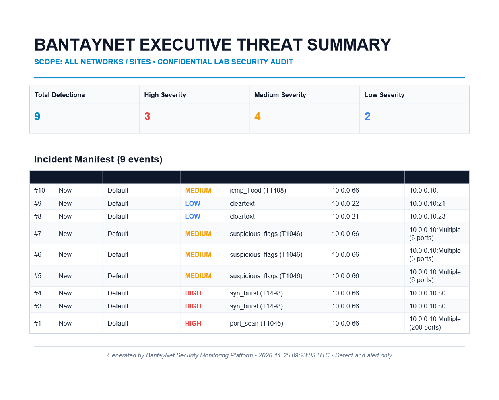

# 🛡️ BantayNet: Suspicious Activity Detection & Forensic PCAP Analysis

[](https://www.python.org/)
[](https://flask.palletsprojects.com/)
[](https://scapy.net/)
[](https://attack.mitre.org/)
[](https://www.postgresql.org/)
[](https://www.microfocus.com/)
[](https://pytest.org/)
[](LICENSE)

---

## ⚠️ Safety & Lab Policy Notice

> **IMPORTANT:** BantayNet is designed strictly as a **detect-and-alert** passive analysis and digital forensics system.
> * **No Offensive Capabilities:** BantayNet never crafts or injects network packets onto live networks, never scans hosts, never floods services, and never alters or blocks traffic.
> * **Outbound-Only Integrations:** All notification, threat intelligence, and SIEM forwarders are strictly outbound, off by default, and isolated. A network or API failure in an integration will never interrupt, slow down, or stop packet analysis.
> * **Authorized Analysis Only:** Use BantayNet exclusively on authorized capture files (`.pcap`/`.pcapng`) and lab network environments.

---

## 📖 Overview

**BantayNet** is a rule-based network intrusion detection and forensic analysis platform built for security analysts, incident responders, and IT administrators. It ingests packet captures, correlates connection metadata across sliding capture-time windows, maps incidents to standard **MITRE ATT&CK®** techniques, and provides investigation tools through both a web dashboard and a command-line interface.

### Key Capabilities:
* **7 Detection Engines:**
  * **Port Scan (`T1046`):** Probing across many target ports on a host within a fast window.
  * **Slow Scan (`T1046`):** Low-and-slow reconnaissance over extended time windows.
  * **Host Sweep (`T1018`):** Scanning a specific target port across multiple subnet addresses.
  * **SYN Flood Burst (`T1498`):** High-volume unacknowledged SYN packets targeting one service.
  * **Suspicious Flags (`T1046`):** Evasive TCP scans (NULL scan, XMAS tree, and bare FIN).
  * **Cleartext Protocols (`Policy`):** Unencrypted transmission of credentials (Telnet, FTP, POP3, IMAP).
  * **ICMP Flood (`T1498`):** High-rate ICMP echo request bursts indicative of denial-of-service.
* **Forensic Evidence Snippets:** Automatically carves and SHA-256 hashes isolated mini-PCAP snippets containing only the matching packets for forensic integrity.
* **Threat Intelligence & SIEM Export:** Enriches public IP addresses using AbuseIPDB and streams alerts to SIEM platforms (Wazuh, Graylog, Splunk, ArcSight) via ArcSight CEF:0 and JSON Syslog over UDP or TCP.
* **Executive & Dossier PDF Reports:** One-click generation of audit-ready summary and incident dossiers with cryptographic hash verification.
* **Flexible Storage:** Native support for Supabase / PostgreSQL and XAMPP MySQL/MariaDB with automatic zero-configuration fallback to local SQLite (`bantaynet.db`).
* **Role-Based Access Control (RBAC):** Admin, Analyst, and Viewer roles with TOTP 2FA, emergency backup codes, and tamper-evident audit logging.

---

## 📸 Screenshots

| Security Dashboard & Alert List | Incident Triage & Forensic PCAP Inspection |
| :---: | :---: |
| <br>*(Main alert list, active filters, and statistics)* | <br>*(Analyst notes, AbuseIPDB reputation, and evidence download)* |

| MITRE ATT&CK Matrix Alignment | Executive Incident PDF Report |
| :---: | :---: |
| <br>*(Direct technique links and tactic categorization)* | <br>*(Exportable audit-ready incident summary)* |

---

## 🚀 Installation & Setup

### 1. Prerequisites
* **Python 3.10** or higher.
* Git.
* (Optional) XAMPP MariaDB/MySQL or Supabase PostgreSQL instance.

### 2. Clone and Create Virtual Environment

#### On Linux / macOS:
```bash
git clone https://github.com/your-org/Bantaynet.git
cd Bantaynet
python3 -m venv venv
source venv/bin/activate
pip install -r requirements.txt
```

#### On Windows (PowerShell):
```powershell
git clone https://github.com/your-org/Bantaynet.git
cd Bantaynet
python -m venv venv
.\venv\Scripts\Activate.ps1
pip install -r requirements.txt
```

### 3. Configure Secrets (Optional)
Copy the template configuration file:
```bash
cp .env.example .env
```
Fill in your environment credentials if using external services. If left empty, BantayNet works out-of-the-box using the embedded SQLite engine and local defaults.

---

## 💻 How to Run

### 1. Web Dashboard
Launch the interactive web dashboard:
```bash
python -m dashboard.app
```
*Or with the production WSGI server:*
```bash
python wsgi.py
```
Open **http://127.0.0.1:5000** in your browser.

#### Default Accounts (First Run / Lab Mode):
| Role | Username | Password | Permissions |
| :--- | :--- | :--- | :--- |
| **Admin** | `admin` | `admin123!` | Full control, user administration, rules tuning, delete alerts |
| **Analyst** | `analyst` | `analyst123!` | Triage incidents, save investigation notes, download PCAP evidence |
| **Viewer** | `viewer` | `viewer123!` | Read-only inspection of alerts and reports |

*(You are prompted to change default passwords upon initial login.)*

---

### 2. Command Line Interface (CLI)
Analyze PCAPs and export alerts directly from your terminal:

```bash
# Analyze a sample capture
python -m src.main --pcap pcaps/sample_portscan.pcap

# Analyze with custom rule thresholds and specific client name
python -m src.main --pcap pcaps/sample_suspicious.pcap --rules rules/rules.yaml --client "Branch-1"

# Export alerts to a CSV report
python -m src.main --pcap pcaps/sample_burst.pcap --export reports/burst_alerts.csv

# Export all stored database alerts to CSV
python -m src.main --export reports/all_alerts.csv

# Admin database purge
python -m src.main --clear-db
```

---

## 🔌 Integrations

All integrations are outbound only, off by default, and configured via `rules/rules.yaml` and environment variables. Failures are logged and skipped, never interrupting packet processing.

| Integration | Config Path (`rules/rules.yaml`) | Environment Variables | Protocol & Default Port | Description |
| :--- | :--- | :--- | :--- | :--- |
| **Alert Email** | `notifications.enabled` | `GMAIL_WEBHOOK_URL`, `GMAIL_USER`, `GMAIL_APP_PASSWORD` | HTTPS (443) or SMTP (587) | Sends alert notifications to on-call SOC mailboxes when alerts meet `min_severity`. |
| **Syslog / SIEM** | `integrations.syslog.enabled` | None *(configured in rules.yaml)* | UDP or TCP (Port 514) | Streams ArcSight CEF:0 or JSON logs to Wazuh, Graylog, Splunk, or QRadar. |
| **AbuseIPDB** | `integrations.abuseipdb.enabled` | `ABUSEIPDB_API_KEY` | HTTPS (443) | Enriches public source IPs with abuse scores and reports. Caches lookups for 24 hours. |

### Sample Syslog CEF Output:
```text
CEF:0|BantayNet|BantayNet|1.0|port_scan|Network Service Discovery|high|src=10.0.0.66 dst=10.0.0.10 proto=TCP cs1=T1046 cs1Label=mitre rt=1760000002000
```

---

## 📊 Sample PCAPs & Verification Results

BantayNet includes pre-built synthetic test captures in the `pcaps/` directory. You can regenerate or extend them at any time using `python -m tests.make_synthetic_pcaps`.

| File | Packet Count | Simulated Scenario | Expected Alerts | Actual Detections | Status |
| :--- | :---: | :--- | :--- | :--- | :---: |
| [`sample_normal.pcap`](pcaps/sample_normal.pcap) | 594 | Benign baseline traffic: DNS queries, valid HTTP 3-way handshakes, ICMP pings | **0 alerts** | 0 alerts | **PASS** |
| [`sample_portscan.pcap`](pcaps/sample_portscan.pcap) | 684 | Horizontal reconnaissance: single attacker probing 200 distinct ports in 2.0s | **1 high-severity** (`port_scan`) | 1 high-severity (`port_scan`) | **PASS** |
| [`sample_burst.pcap`](pcaps/sample_burst.pcap) | 868 | Denial-of-Service: 600 unacknowledged SYN packets to web port 80 in 1.2s | **1 high-severity** (`syn_burst`) | 1 high-severity (`syn_burst`) | **PASS** |
| [`sample_suspicious.pcap`](pcaps/sample_suspicious.pcap) | 720 | Multi-vector attack: TCP NULL, XMAS, FIN scans, cleartext Telnet/FTP, ICMP echo flood | **6 alerts** (3 flag scans, 2 cleartext, 1 flood) | 6 alerts (`suspicious_flags` x3, `cleartext` x2, `icmp_flood` x1) | **PASS** |

---

## 🌐 Deployment Notes

* **Local / Lab Mode:** No setup needed. If MySQL is not reachable, BantayNet automatically uses SQLite (`bantaynet.db`) with complete WAL-mode support.
* **On-Premise (XAMPP / MariaDB):** Configure `MYSQL_HOST=127.0.0.1`, `MYSQL_USER`, `MYSQL_PASSWORD`, and `MYSQL_DATABASE=bantaynet_db`. Tables and indexes are automatically provisioned.
* **Cloud / Production (Supabase / Render / Docker):**
  * Set `SUPABASE_DB_URL=postgresql://...` to enable PostgreSQL connection pooling.
  * Run the production server via `python wsgi.py` with Waitress behind an HTTPS reverse proxy (Nginx, Caddy, Cloudflare).
  * Set `BANTAYNET_COOKIE_SECURE=1` to enforce secure cookies and HSTS headers.

---

## ⚠️ Limitations

* **Passive Analysis Only:** BantayNet does not act as an inline Intrusion Prevention System (IPS). It does not reset connections, modify firewall rules, or block IP addresses.
* **Encrypted Payload Inspection:** BantayNet inspects packet headers and cleartext protocols. It does not perform TLS decryption or deep payload inspection on encrypted streams (HTTPS/SSH).
* **Capture Timestamp Dependency:** Detections are evaluated based on capture timestamps embedded within the PCAP headers, ensuring identical results regardless of processing speed.
* **External API Quotas:** AbuseIPDB lookups rely on available API limits (the free tier provides 1,000 queries per day, protected by BantayNet's 24-hour IP cache).

---

## 🧪 Automated Testing

Execute the comprehensive test suite:

```bash
pytest -v
```

The automated test suite verifies:
* All 7 detection rule algorithms, sliding window logic, and cooldown suppression.
* ArcSight CEF:0 and JSON Syslog formatting, character escaping, and UDP/TCP transmission.
* AbuseIPDB IP reputation lookup, public vs. private IP filtering, caching, and error resilience.
* Database operations across SQLite, MySQL, and PostgreSQL with safe migrations.
* RBAC authentication, session security, password policies, and 2FA enforcement.
* Evidence carving, cryptographic SHA-256 tamper-evident integrity checks, and PDF report generation.

---

## 📄 License

This project is licensed under the [MIT License](LICENSE).
